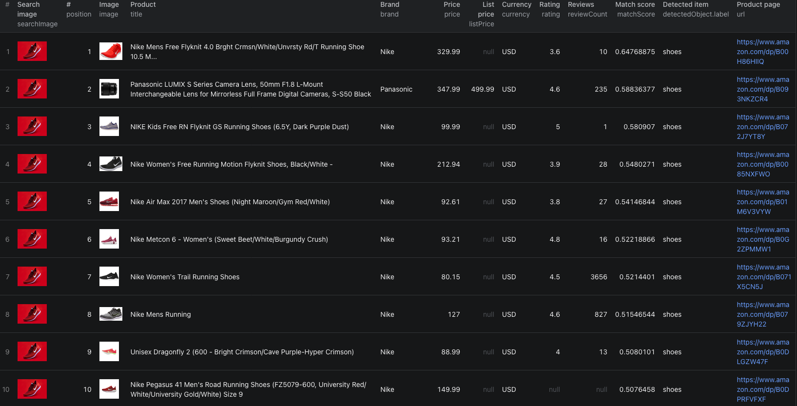

# How to Search Amazon by Image in Node.js

This example shows how to find Amazon products that match a photo in Node.js using the [Amazon Image Search Scraper](https://apify.com/piotrv1001/amazon-image-search-scraper) Actor on Apify. It calls an existing Actor rather than implementing Amazon's photo search from scratch. Amazon detects every item it recognizes in a photo and matches each one, so one outfit or room picture can return products for several items.



## What this example does

- Calls `piotrv1001/amazon-image-search-scraper`
- Passes direct image URLs, the Amazon marketplace, and a per-image result limit
- Waits for the Actor run to finish
- Fetches the matching products from the run's dataset, best matches first
- Prints each structured result

## Prerequisites

- [Node.js](https://nodejs.org) 18 or newer
- An [Apify account](https://console.apify.com/sign-up)
- An Apify API token from **Settings → Integrations**
- Direct JPEG or PNG URLs no larger than 5 MB

## Installation

```bash
npm install
```

## Environment setup

```bash
cp .env.example .env
```

Add your token to `.env`:

```env
APIFY_TOKEN=your_apify_token_here
```

## Usage

```bash
npm start
```

## Code example

```js
import { ApifyClient } from 'apify-client';
import 'dotenv/config';

// Initialize the ApifyClient with your Apify API token
// Set APIFY_TOKEN in your .env file (copy .env.example to get started)
const client = new ApifyClient({
    token: process.env.APIFY_TOKEN,
});

// Prepare Actor input
const input = {
    imageUrls: [
        'https://images.unsplash.com/photo-1542291026-7eec264c27ff?w=800',
        'https://images.unsplash.com/photo-1555041469-a586c61ea9bc?w=800',
    ],
    marketplace: 'amazon.com',
    maxResultsPerImage: 50,
    proxyConfiguration: {
        useApifyProxy: true,
    },
};

// Run the Actor and wait for it to finish
const run = await client.actor('piotrv1001/amazon-image-search-scraper').call(input);

// Fetch and print Actor results from the run's dataset (if any)
console.log('Results from dataset');
console.log(`💾 Check your data here: https://console.apify.com/storage/datasets/${run.defaultDatasetId}`);
const { items } = await client.dataset(run.defaultDatasetId).listItems();
items.forEach((item) => {
    console.dir(item);
});

// 📚 Want to learn more 📖? Go to → https://docs.apify.com/api/client/js/docs
```

## Example output

[`sample-output.json`](./sample-output.json) contains the top match for each of the two example photos, a running shoe and a velvet sofa. Key fields include the query image, position, ASIN and URL, title, brand, price, list price, currency, rating, review count, availability, product group, variation and color counts, Amazon's match score, the detected item with its position in the photo, and the marketplace.

Supported marketplaces: `amazon.com`, `amazon.co.uk`, `amazon.de`, `amazon.it`, `amazon.es`, and `amazon.in`. Amazon usually shows 10 to 60 matches per photo, with no further pages.

## Use cases

- Match catalogue photos to Amazon ASINs without guessing title keywords
- Find Amazon listings that look like a product seen elsewhere
- Compare prices, ratings, and review counts of visually similar products
- Turn outfit or room photos into Amazon products for every item
- Compare what different Amazon marketplaces show for the same photo

## Try the Actor on Apify

**[Open the Amazon Image Search Scraper on Apify](https://apify.com/piotrv1001/amazon-image-search-scraper)**

## Related resources

- [How to Search Amazon by Image and Match Photos to ASINs](https://www.falconscrape.com/blog/how-to-search-amazon-by-image)
- [Amazon Product & Buy Box Scraper](https://apify.com/piotrv1001/amazon-product-buy-box-scraper)
- [Apify JavaScript client documentation](https://docs.apify.com/api/client/js/docs)

## License

MIT
